<p align="center">
  
</p>

<h1 align="center">GoVue</h1>

<p align="center">
  <strong>Watch YouTube. Learn from every line.</strong><br>
  Native playback, searchable captions, saved vocabulary, and AI conversations on Android and iOS.
</p>

<p align="center">
  <a href="https://github.com/kosumic/GoVue/actions/workflows/ci.yml"></a>
  <a href="LICENSE"></a>
  <a href="https://expo.dev"></a>
  <a href="https://www.rust-lang.org/"></a>
  <a href="https://nodejs.org/"></a>
  <a href="https://x.com/Kosumi1989"></a>
</p>

<p align="center">
  <a href="https://youtu.be/apYmn1kmMcQ"></a><br>
  <a href="https://youtu.be/apYmn1kmMcQ"><strong>Watch the GoVue launch video</strong></a>
</p>

GoVue brings YouTube browsing and language learning into one mobile app. Find a
video, follow its captions, replay a phrase, save an unfamiliar word, or ask your
chosen AI model about what you just watched. Comments, recommendations,
subscriptions, and account pages remain available through YouTube's web interface.

GoVue began as a Rust-native port of [LiTube](https://github.com/HydeYYHH/Litube).
It now combines shared React Native presentation with a Rust core and small
Kotlin and Swift platform adapters.
Android is the first implementation and verification target; the port is in
progress. See [project status](#project-status) for verified behavior and open work.

## Contents

- [Preview](#preview)
- [What you can do](#what-you-can-do)
  - [Watch with native controls](#watch-with-native-controls)
  - [Read along in two languages](#read-along-in-two-languages)
  - [Build vocabulary from what you watch](#build-vocabulary-from-what-you-watch)
  - [Talk to your own AI models](#talk-to-your-own-ai-models)
  - [Create learning games with the agent](#create-learning-games-with-the-agent)
  - [Keep videos for later](#keep-videos-for-later)
- [Get started](#get-started)
- [How it works](#how-it-works)
  - [Data and connections](#data-and-connections)
- [Architecture](#architecture)
  - [React Native Frontend](#react-native-frontend)
  - [GoVue Rust Core](#govue-rust-core)
- [Development](#development)
  - [Android](#android)
  - [iOS](#ios)
  - [Generated files](#generated-files)
  - [Validation](#validation)
- [Project status](#project-status)
- [Documentation](#documentation)
- [Community](#community)
- [Credits](#credits)
- [License](#license)

## Preview

<table>
  <tr>
    <td align="center">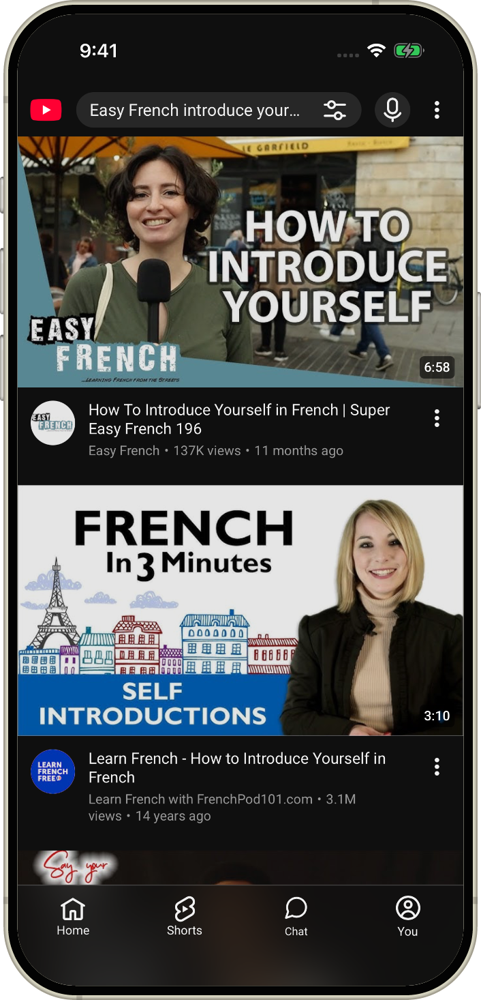</td>
    <td align="center">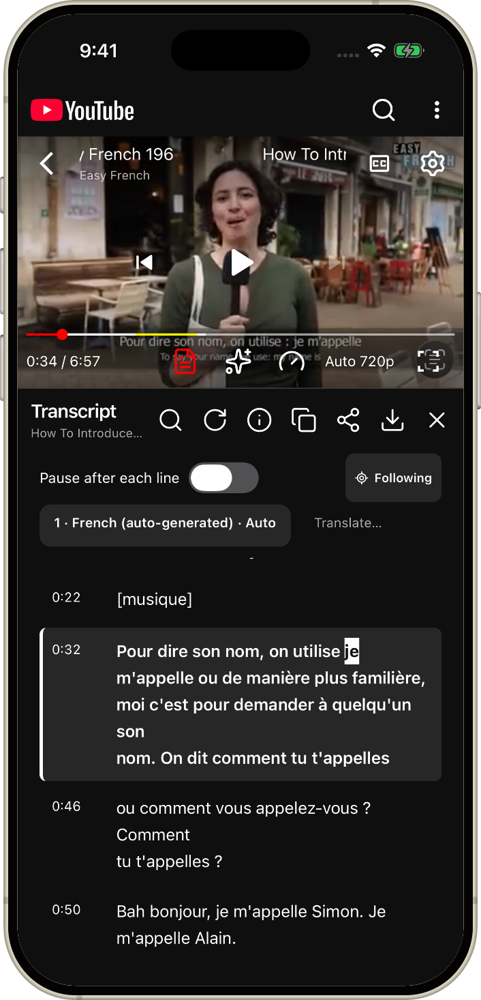</td>
  </tr>
  <tr>
    <td align="center"><strong>Find something to learn</strong><br>Browse YouTube's videos, channels, and recommendations.</td>
    <td align="center"><strong>Read in two languages</strong><br>Follow French and English in separate panes, and tap to seek.</td>
  </tr>
  <tr>
    <td align="center">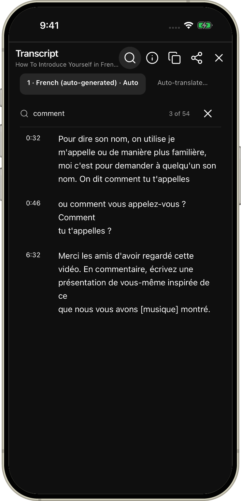</td>
    <td align="center">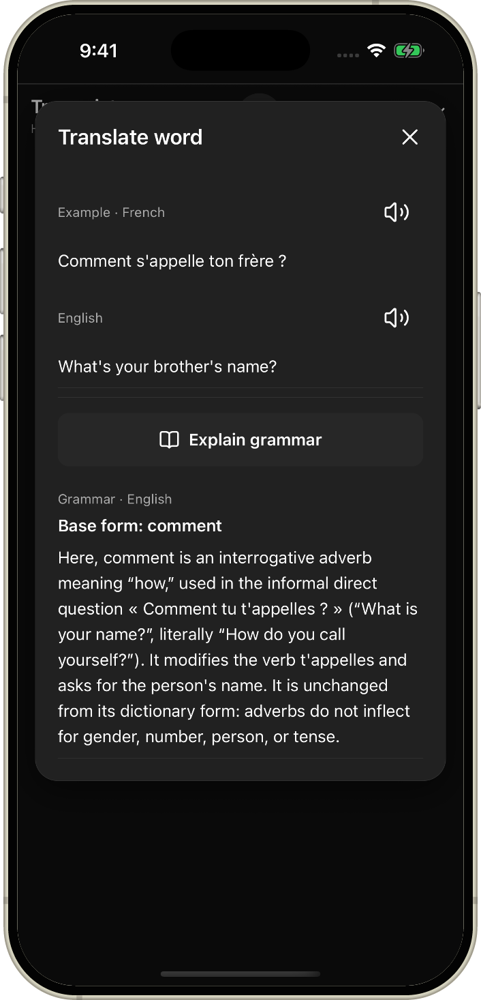</td>
  </tr>
  <tr>
    <td align="center"><strong>Find phrases to practice</strong><br>Search French captions for words and expressions.</td>
    <td align="center"><strong>Select a word or phrase</strong><br>Drag the handles and choose an AI model for examples and grammar.</td>
  </tr>
  <tr>
    <td align="center">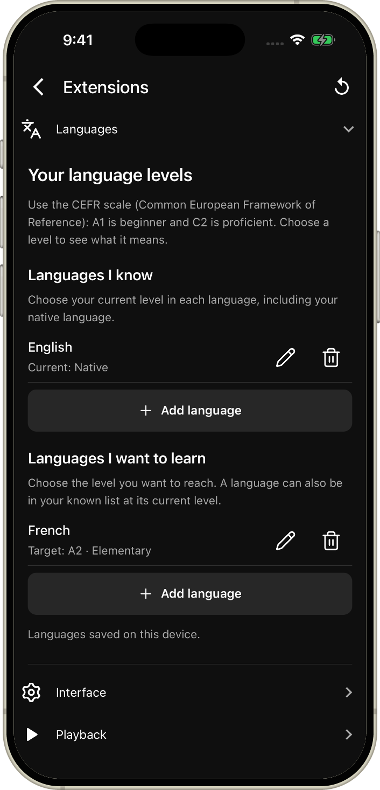</td>
    <td align="center">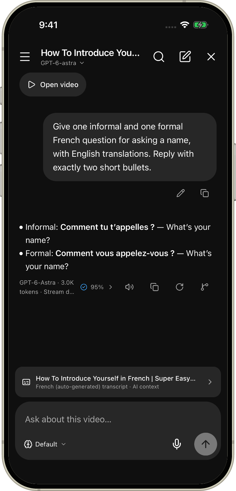</td>
  </tr>
  <tr>
    <td align="center"><strong>Set your learning goals</strong><br>Keep the languages you know and the levels you want to reach.</td>
    <td align="center"><strong>Ask about the lesson</strong><br>Use your AI model with the video's transcript attached.</td>
  </tr>
  <tr>
    <td align="center">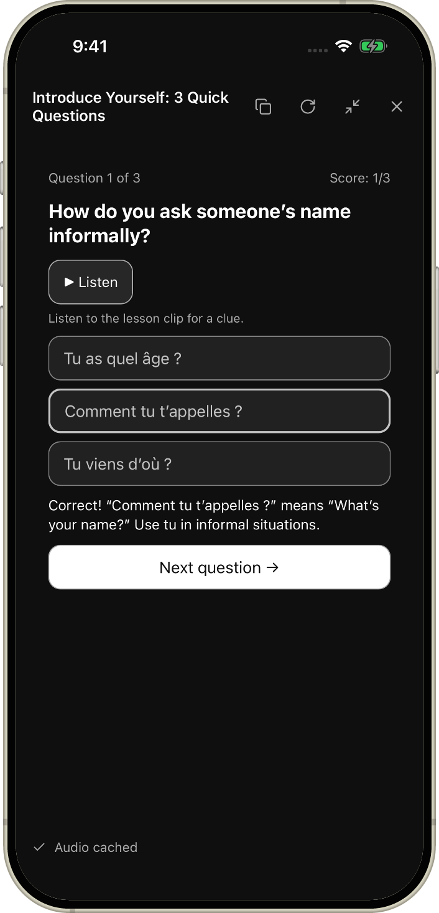</td>
    <td align="center">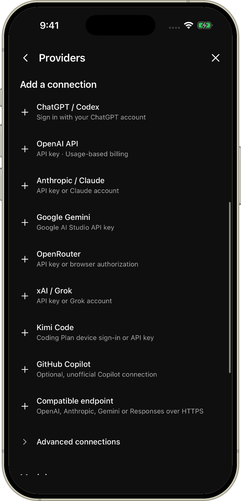</td>
  </tr>
  <tr>
    <td align="center"><strong>Ask the agent for a learning game</strong><br>Turn a lesson into a playable quiz with original caption audio.</td>
    <td align="center"><strong>Connect your AI</strong><br>Sign in with an account or choose an API connection.</td>
  </tr>
  <tr>
    <td align="center">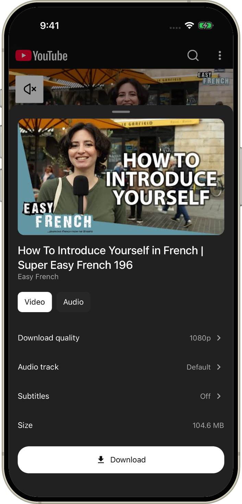</td>
    <td align="center">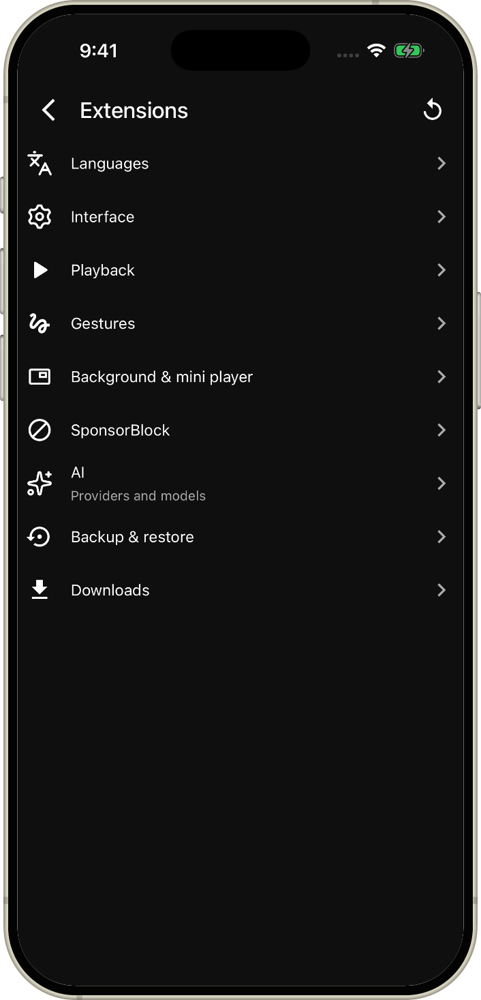</td>
  </tr>
  <tr>
    <td align="center"><strong>Keep a lesson for later</strong><br>Choose video or audio, quality, and caption attachments.</td>
    <td align="center"><strong>Make GoVue yours</strong><br>Manage playback, gestures, SponsorBlock, AI, and downloads in Extensions.</td>
  </tr>
</table>

Captured in the iPhone 17 Pro simulator running iOS 26.5, with changed screens
refreshed from the GoVue 0.2.0 ARM64 release build. Framed with the same iPhone
mockup as Whip, using Easy French's
[lesson on introducing yourself](https://www.youtube.com/watch?v=tCd_4uCD5eo).
[Capture details](assets/screenshots/README.md).

## What you can do

### Watch with native controls

- Play videos in an embedded player, fullscreen, or a floating mini-player while
  keeping YouTube comments and recommendations interactive.
- Choose speed, quality, audio tracks, and captions; browse chapters and manage
  the playback queue.
- Continue with background audio and picture-in-picture through Expo Video.
- Configure SponsorBlock categories, caption appearance, gestures, and playback
  preferences in **Extensions**.

### Read along in two languages

- Open **Transcript** from the player to search captions, follow playback, and
  tap a line or a timed word to seek.
- Compare up to two languages in equal-height panes. Search either language;
  copy and share include both.
- Keep authored line breaks, emphasis, and Japanese pronunciation readings.
- Choose available caption tracks or YouTube machine translations, inspect
  caption details, and reuse normalized transcripts from the on-device cache.

### Build vocabulary from what you watch

- Set the languages you know and want to learn, including current and target
  levels, under **Extensions → Languages**.
- Hold a transcript word to translate it on device and save it with its video
  context and timestamp.
- Drag the selection handles to translate and save a whole phrase, or choose
  an AI provider directly in the card.
- Ask your selected AI model for translated usage examples or an explanation of
  the word's base form and grammar in the current caption.
- Listen to examples with text-to-speech or use **Play word** to hear the original
  video audio. Exact word playback depends on available word timings.

On-device translation may download a language model on first use. Android uses
ML Kit; iOS translation requires iOS 18 or newer.

### Talk to your own AI models

- Open **AI** from a video to reuse its saved conversation with transcript context,
  or open **Chat** from the bottom navigation. Opening a chat does not send a message.
- Configure providers, accounts, models, and fallback or round-robin model groups
  under **Extensions → AI**. Connections include ChatGPT / Codex, OpenAI API,
  Claude, Gemini, OpenRouter, Grok, Kimi Code, optional Copilot, and compatible endpoints.
- Stream replies with Markdown and provider-supplied reasoning, change reasoning
  effort for the next turn, regenerate responses, and inspect local token usage.
- Search messages and conversations; pin, archive, rename, or delete saved chats.
- Dictate questions, read answers aloud, and save **AGENT.md instructions** for
  your preferred language, learning level, or response style.

Account eligibility and model access depend on the provider. See the
[reader and chat guide](docs/reader-and-chat.md) for controls, timing behavior,
voice input, and usage statistics, and the
[interactive games reference](docs/interactive-games.md) for the game runtime.

### Create learning games with the agent

Ask the agent something like **“Create a French quiz from this video, with audio
clips and explanations in English.”** It creates a game you can play inside the
conversation or expand to fill the screen.

- Practice with the lesson's original caption audio and feedback on your answers.
- Return to saved games in **Practice**, with progress kept between sessions.
- Ask the agent to adapt the activity to your language level or learning goals.

### Keep videos for later

- Choose video or audio downloads, quality, audio track, subtitles, cover images,
  and filenames.
- Manage individual downloads or playlist and queue batches, with pause, resume,
  retry, offline playback, and file export.
- Publish verified downloads to **Downloads/GoVue** on Android 10 and newer.
- Export and import extension settings.

Downloads currently target finite MP4 video and M4A audio. Live downloads and
durable partial-download recovery after process termination remain open.

## Get started

Build a native app using the [Android](#android) or [iOS](#ios) instructions below.
GoVue needs its local Rust module and cannot run in Expo Go.

1. Open YouTube and choose a video with captions.
2. Tap **Transcript** in the player. Select one or two languages and tap a caption
   to follow it in the video.
3. Set your languages in **Extensions → Languages**, then hold a word in the
   reader to translate or save it.
4. Add a provider and model in **Extensions → AI**, open **AI** from the video,
   and send your own question about the transcript.

GoVue was formerly named LingoPlay. Existing installations keep their application
identifiers, credentials, data directories, and backup format markers. New links
use `govue://`; existing `lingoplay://` links still work.

## How it works

YouTube's WebView supplies browsing, comments, subscriptions, and account pages.
GoVue places its native player over the page's reported video bounds, keeping
comments and recommendations interactive. The WebView stays mounted when the
reader opens; embedded, fullscreen, and mini-player layouts share one mounted
video surface.

Playback, subtitles, and downloads use the Rust extractor independently of the
browsing page. Platform adapters supply bounded HTTPS requests; isolated runtimes
handle token challenges and signature code. The current guest extractor does not
select formats requiring signature/throttle evaluation and has no page-extraction
fallback. See [extraction](docs/extraction.md) for the protocol and limitations.

### Data and connections

Normalized transcripts, saved words, chats, settings, and history live in the
native sandbox. Signed media/caption URLs and raw upstream responses stay in
memory and are excluded from persistent metadata and logs. Provider credentials
use Android Keystore-backed storage or iOS Keychain.

AI requests go directly to the selected provider. Attached transcript context is
sent with your questions. Local token statistics describe saved history and do
not represent provider billing or subscription quotas.

Native playback uses opaque media routes bound to loopback. Casting uses a
separate, revocable listener on the current private Wi-Fi address; see the
[casting networking policy](docs/cast-networking.md) and its
[verification status](PORTING.md#scoped-cast-transport-2026-10-17).

## Architecture

GoVue shares its React Native presentation and Rust core between Android and
iOS. React Native owns presentation and browser integration; Rust owns
application logic, validation, state, and persistence. Kotlin and Swift adapt
platform APIs through the [local Expo module](modules/govue-core/).

### React Native Frontend

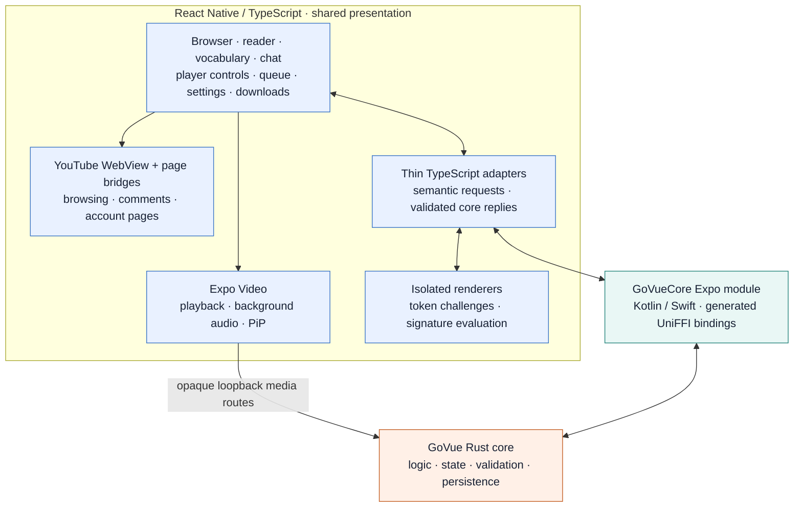

[App.tsx](App.tsx) and [src/](src/) render the shared browser, player controls,
reader, vocabulary, chat, settings, and download screens. The
[YouTube bridges](src/youtube/) coordinate the page and web player, while
[isolated runtimes](src/media/) execute token challenges and signature code in
separate renderers. Expo Video owns playback, background audio, and PiP.

### GoVue Rust Core

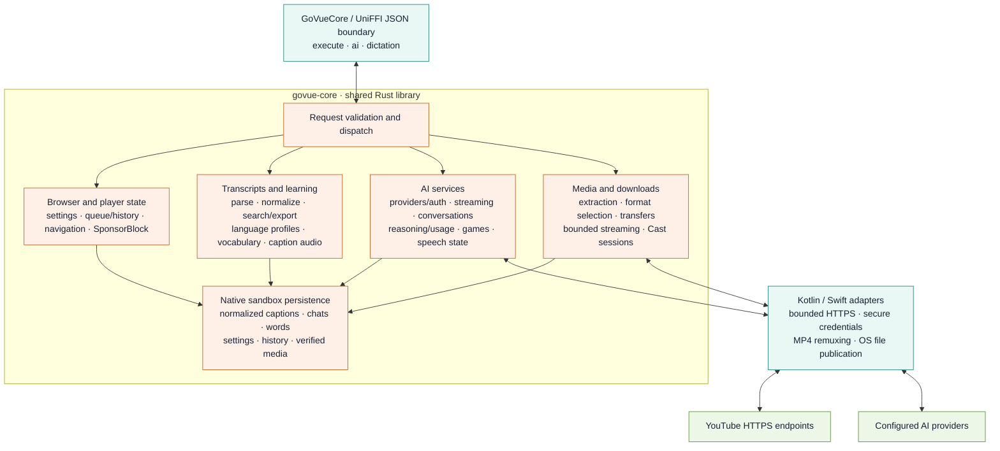

The [Rust core](core/) validates requests and owns caption processing, media
selection, AI protocols, game transitions, settings, queue/history, and download
planning and transfer state. Kotlin and Swift provide network bytes, secure
credential storage, file publication, and MP4 remuxing. Signed upstream addresses
remain in memory; local playback receives scoped routes from Rust's media server.

## Development

GoVue uses React Native 0.86 and Expo SDK 57 with custom native builds. The
[Nix flake](flake.nix) supplies Node.js 24, **Rust 1.99.0**, and the platform
dependencies. Rust is pinned in [rust-toolchain.toml](rust-toolchain.toml);
Node.js 24.15 or newer is required for the TypeScript build scripts. Enter the
development shell before installing dependencies.

### Android

On Linux, the shell includes JDK 17, Android SDK Platform 36, NDK, and CMake.
Connect an ARM64 device with USB debugging enabled:

```sh
nix develop path:.
npm ci
npm run android
```

Gradle builds the Rust library and bindings automatically. The Nix shell limits
Android builds to `arm64-v8a`.

For Metro over USB, run these inside the development shell:

```sh
adb reverse tcp:8081 tcp:8081
npm start
```

If the development client needs to be opened manually, use another terminal:

```sh
adb shell am start -a android.intent.action.VIEW \
  -d 'govue://expo-development-client/?url=http%3A%2F%2F127.0.0.1%3A8081' \
  io.github.kaminarios.lingoplay
```

To build and install a standalone APK from the repository root, inside the shell:

```sh
npm run core:android
npx expo prebuild --platform android --no-install
NODE_ENV=production android/gradlew -p android :app:assembleRelease \
  -PreactNativeArchitectures=arm64-v8a
adb install -r android/app/build/outputs/apk/release/app-release.apk
```

This bundles JavaScript and runs without Metro. The generated release variant
currently uses the development signing key; production signing is not configured.

### iOS

Use an Apple Silicon Mac with Xcode, after verifying shared changes on Android:

```sh
nix develop path:.
npm ci
npm run ios
```

`npm run ios` builds the Rust device and simulator libraries, generates the
XCFramework and Swift bindings, then runs Expo. Use `npm run prebuild:ios` to
generate the native project without launching it. Keep Nix's host SDK/compiler
overrides out of Xcode builds; the Darwin shell and Rust build script select
Xcode's tools for Apple targets.

### Generated files

`npm ci` applies the local native patches and bundles the injected browser code.
After changing `src/youtube/pageBridge.js`, the LiTube browser scripts, or decoder
and token sources under `scripts/`, regenerate the bundles:

```sh
npm run page:build
```

Root `android/` and `ios/` projects, generated bindings, compiled Rust libraries,
and browser bundles are ignored. Keep persistent native configuration in
[app.json](app.json) or [config plugins](plugins/), and native adapter sources in
[modules/govue-core](modules/govue-core/). Regenerate bindings with
`npm run core:android` or `npm run core:ios`.

The app version comes from `package.json` through [app.config.js](app.config.js),
including Android, iOS, About, and diagnostics. Bump it with
`npm version patch --no-git-tag-version` (or `minor`, `major`, or an explicit
version). Release tags must match that version; `npm run check:app-version`
checks the Expo configuration.

Android builds `expo-video` from source to include `scripts/patch-video.ts`;
keep its postinstall patch and autolinking override together.

### Validation

Get behavior working on a live Android device, then run inside the shell:

```sh
npm run check
npx expo install --check
```

These cover JavaScript/TypeScript lint, type checking, injected browser behavior,
Rust formatting, Clippy, and Rust boundary/cache tests. CI also audits Rust
dependencies, runs CodeQL and PR dependency review, submits the native dependency
graph, builds and lints an ARM64 Android APK, then compiles an unsigned ARM64 iOS
app. See [CI documentation](.github/CI.md). Fixture and compile checks complement
live device verification.

## Project status

The LiTube port follows commit `bb9ee78428a30347fc6eaf21a679f2a0b8cbc91f`
(2026-10-16). [PORTING.md](PORTING.md) records the acceptance inventory, device
evidence, and remaining gaps; implemented controls still need verification.

| Area | Current evidence and remaining work |
| --- | --- |
| Android | Pixel checks cover native VOD/live playback, quality and speed changes, captions, fullscreen/mini-player transitions, transcript context, and saved video chats. Comprehensive gesture and menu verification remains open. |
| Downloads | Video and cover publication, read-back integrity, and reuse after restart were checked on the Pixel. Durable partial recovery remains open. |
| PiP and background audio | A protected PiP audio handoff passed. The latest transition refinement, physical button checks, and extended background behavior remain open. |
| Cast | Shared playback, pause/resume, seek, and revocation were checked through a USB relay. Direct Wi-Fi, physical receivers, and iOS adapters remain open; further Cast work is deferred. |
| iOS | An ARM64 release build, native VOD playback, captions, bilingual reading, settings, and ChatGPT / Codex sign-in with a real reply were checked in the iPhone 17 Pro simulator on iOS 26.5. The account connection and saved chat survived restart. Physical iPhone and full feature verification remain open. |

The current standalone extractor uses a guest client. Sign-in-required videos
and videos unavailable to that client fail explicitly, even if the browsing
WebView is signed in. Available formats and captions depend on YouTube.

## Documentation

- [Reader, vocabulary, and chat guide](docs/reader-and-chat.md)
- [Interactive games and caption audio](docs/interactive-games.md)
- [Standalone extraction and cache boundaries](docs/extraction.md)
- [Porting inventory and verification evidence](PORTING.md)
- [Casting networking policy](docs/cast-networking.md)
- [CI and dependency automation](.github/CI.md)
- [Core request lock profiling](docs/core-lock-profiling.md)
- [Historical feature and profiling notes](docs/legacy-features.md) — includes
  superseded extraction and UI descriptions.

## Community

- Report reproducible bugs and request features through
  [GitHub Issues](https://github.com/kosumic/GoVue/issues).
- Follow [@Kosumi1989](https://x.com/Kosumi1989) for project updates.

Feedback is especially useful around Android playback, transcript and vocabulary
workflows, AI connections, and iOS compatibility. Include the platform, build,
steps to reproduce, and any relevant public video when reporting a problem.

## Credits

GoVue began as a Rust-native port of [LiTube](https://github.com/HydeYYHH/Litube),
whose browser integration and player experience underpin the app. The model
provider implementation is also ported from
[OpenMinis](https://github.com/OpenMinis/OpenMinis) into the shared Rust core.
[Whip](https://github.com/KaminariOS/whip) is an engineering and documentation
reference. Thanks to these projects and their contributors. Upstream attribution
and dependency licenses are in [third-party notices](notices/README.md).

## License

GoVue is licensed under [GNU GPL version 3](LICENSE).

Third-party work remains subject to its original terms; see
[third-party notices](notices/README.md).
